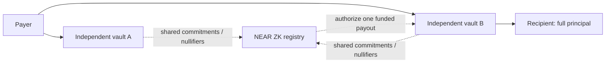

# Core Front — invoices, proofs and business workflows

[English](README.md) · [한국어](README.ko.md) · [简体中文](README.zh-CN.md)

NEAR 기반 기업 프라이빗 정산: 독립 볼트가 원금을 보관하고, 공유 영지식 노트가 지급을 승인하며, 선택 공개 증빙으로 정산을 확인합니다.

Front는 Next.js 랜딩·문서·앱 저장소입니다.

`/relay/`에서 선택적 지연 실행을 지원합니다. 실행 시간을 한 번 추첨해 저장하고, 배치당 최대 8개의 개별 거래와 대기·취소·만료·원본 요청 복구를 처리합니다. [지연 실행 가이드](https://github.com/Company-privacy-settlement/Core/blob/main/docs/SCHEDULED_DELIVERY.md). 익명성 입증이나 공개 릴레이 운영을 의미하지 않습니다.

지연 실행 검증: **Core 565개 테스트**, **Front 단위 테스트 8개**, 실제 네이티브/FT WASM·Groth16 스케줄링과 데스크톱·모바일 대기·복구·증명 UX를 검증했습니다. 공개 USDC와 외부 HTTPS 릴레이 실증은 별도입니다.

## 프로젝트 소개

기업은 인보이스 내용과 업무 문서를 온체인에 공개하지 않으면서 공급사·직원·계약자에게 지급해야 합니다. Core는 수취인 서명 요청, 로컬 증명과 검토 가능한 증빙을 결합하고 원금 보관을 여러 볼트로 분산합니다.

[Hackathon guide](https://github.com/Company-privacy-settlement/Core/blob/main/docs/HACKATHON.md) · [Web Docs](https://core-private-settlement-0574c4.jiheon6768.chatgpt.site/docs/) · [Core](https://github.com/Company-privacy-settlement/Core) · [Contract](https://github.com/Company-privacy-settlement/Contract) · [Front](https://github.com/Company-privacy-settlement/Front)

## 데모 보기

[](https://github.com/Company-privacy-settlement/Front/blob/main/public/media/core-hackathon-demo-en.mp4)

[Watch English MP4](https://github.com/Company-privacy-settlement/Front/blob/main/public/media/core-hackathon-demo-en.mp4) · [Captions, transcript & chapters](https://github.com/Company-privacy-settlement/Front/blob/main/docs/HACKATHON_DEMO.md) · [Hosted video player](https://core-private-settlement-0574c4.jiheon6768.chatgpt.site/media/)

영문 내레이션·자막과 실제 앱 화면을 제공합니다. 브라우저 구간은 지갑/API 테스트 환경임을 표시하고 실제 로컬 증명을 생성합니다. 별도 구간에서 기록된 네이티브 NEAR 공개 테스트넷 실증을 보여줍니다.

저장소·사이트 접근은 기존 권한을 따릅니다. 영상은 Front에 보관되므로 심사자는 Front 접근 권한이나 다운로드 영상 패키지가 필요합니다. 제출 준비로 공유 권한을 변경하지 않습니다.

## 구현한 기능

| 기능 | 구현 |
| --- | --- |
| 인보이스→결제 | 서명 요청→암호화 노트→로컬 증명→금액/수수료→지갑 호출→확정. |
| 프라이빗 작업 공간 | 노트·증명 검증/취소·선택 증빙·암호화 로컬 저널. |
| 조직 | 멤버/역할·인보이스 대시보드·결제 승인·일괄 송금·웹훅·심사 흐름. |
| 세무 초안 | 출처 기반 개요·선택적 AI 계획·불변 리비전·독립 검토. |
| 문서 | 영문 기본 랜딩과 웹 가이드 10개, 한·중·영 README. |

## 로컬 실행

Node.js 22.16+가 필요합니다. 형제 저장소·API 키 없이 빌드하며 정적 출력은 `out/`입니다. 브라우저 정산은 독립적으로 신뢰한 FT 정책과 별도 Core·조직 API가 필요합니다. 네이티브 증거 정책을 USDC 브라우저 정책으로 사용할 수 없습니다.

```bash
npm ci
npm run dev
# Production export and checks
npm run check
npm test
npm run build
```

Routes: `/docs/`, `/invoices/`, `/pay/`, `/notes/`, `/prove/`, `/evidence/`, `/organization/`, `/rules/`, `/kyb/`, `/live/`. Demo media is under `public/media/`; fixture recording tools are under `scripts/demo/` and are excluded from the application runtime.

## 실제 테스트넷 증거

2026-11-14 **실제 공개 테스트넷 거래 14건을 FINAL로 확인**했습니다. 배포·키 제거, 0.1 NEAR 입금 2건, 출금과 수취인 미생성 실패 후 원래 목적지 복구를 검증했습니다. 두 수취인은 각각 원금 0.1 NEAR 전액을 받았고 재시도 프로토콜 수수료는 0입니다. 레지스트리·볼트 2개는 키리스이며, 별도 읽기 전용 검증기로 영수증·서명·과거 입출금 전후 잔액·프로토콜 수수료 합계 0.0006 NEAR를 확인했습니다.

[Testnet run and transaction links](https://github.com/Company-privacy-settlement/Core/blob/main/docs/TESTNET_WALLET.md) · [Public evidence](https://github.com/Company-privacy-settlement/Core/blob/main/docs/evidence/testnet-wallet-2026-11-14.json)

최근 기록된 엔지니어링 검증은 **Core 513개 테스트**와 SDK·타입 빌드·컴파일 서비스 재시작/백업/복구입니다. 브라우저 테스트 환경과 공개 네이티브 실거래 증거는 구분합니다.

## 구조와 수수료



입금·출금 각각 **0.15%를 원금에 추가**합니다. 수취인은 원금 전액을 받습니다. NEAR 작업 저장비·토큰 등록·계정 활성화·네트워크 가스는 별도입니다.

ZK는 사용한 입력 노트의 연결을 숨깁니다. 서명자·수취인·시간·고정 금액·볼트·자금 출처는 공개됩니다. 단일 payer 실증은 실효 익명성의 증거가 아닙니다. Cover traffic 스케줄러는 없으며 그룹당 총 출력 한도는 현재 256개입니다.

## 범위와 다음 단계

**해커톤·개발 프로토타입**입니다. 설정은 `UNSAFE_LOCAL_DEVELOPMENT_ONLY`입니다. 공개 테스트넷 검증 범위는 로컬 Ed25519 소프트웨어 지갑의 네이티브 NEAR입니다. 실제 브라우저 지갑·USDC 실행, 외부 API HTTPS 운영, 원격 Actions 성공과 프로덕션 보안 검토는 남아 있습니다.

다음 우선순위는 외부 호스팅 릴레이 실증, 추가 프라이버시 측정과 예산을 제한한 cover traffic 실험입니다. 실제 KYB/AI 제공자 운영 검증·전문가 규칙 승인·법정 신고는 별도입니다.

## 프로젝트 살펴보기

[Service](https://github.com/Company-privacy-settlement/Core/blob/main/docs/SERVICE.md) · [Privacy](https://github.com/Company-privacy-settlement/Core/blob/main/docs/PRIVACY.md) · [Invoices](https://github.com/Company-privacy-settlement/Core/blob/main/docs/INVOICE_PAYMENTS.md) · [Organizations](https://github.com/Company-privacy-settlement/Core/blob/main/docs/ORGANIZATIONS.md) · [Tax drafts](https://github.com/Company-privacy-settlement/Core/blob/main/docs/TAX_DRAFTS.md) · [Deployment](https://github.com/Company-privacy-settlement/Core/blob/main/docs/DEPLOYMENT.md) · [Hosting](https://github.com/Company-privacy-settlement/Core/blob/main/docs/PRODUCTION_HOSTING.md) · [CI](https://github.com/Company-privacy-settlement/Core/blob/main/docs/CI.md) · [Roadmap](https://github.com/Company-privacy-settlement/Core/blob/main/docs/ROADMAP.md)
