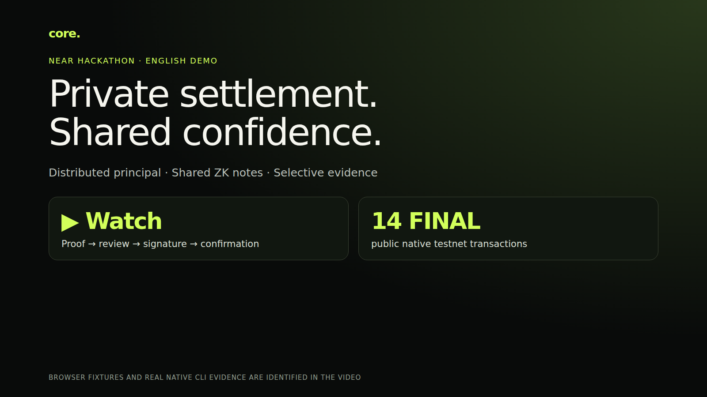
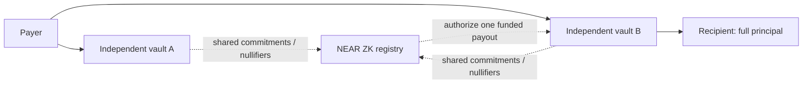

# Core Front — invoices, proofs and business workflows

[English](README.md) · [한국어](README.ko.md) · [简体中文](README.zh-CN.md)

Private business settlement on NEAR: independent vaults hold principal, shared zero-knowledge notes authorize payouts, and selective evidence supports reconciliation.

Front is the Next.js landing, documentation and application repository.

Optional delayed delivery is available at `/relay/`: persistently sampled execution windows, batches of up to eight separate transactions, waiting/cancellation/expiry and original-request recovery. [Scheduling guide](https://github.com/Company-privacy-settlement/Core/blob/main/docs/SCHEDULED_DELIVERY.md). This does not establish anonymity or a live hosted relay.

Scheduled-delivery validation: **565 Core tests**, **8 Front unit tests**, real native/FT WASM and Groth16 scheduling checks, and desktop/mobile delivery/recovery/proof UX regressions. Public USDC and a hosted HTTPS relay remain separately unqualified.

## The idea

Businesses need to pay suppliers, employees and contractors without putting invoice terms and business records on-chain. Core combines signed payment requests, local proofs and reviewable evidence while keeping custody distributed across vaults.

[Hackathon guide](https://github.com/Company-privacy-settlement/Core/blob/main/docs/HACKATHON.md) · [Web Docs](https://core-private-settlement-0574c4.jiheon6768.chatgpt.site/docs/) · [Core](https://github.com/Company-privacy-settlement/Core) · [Contract](https://github.com/Company-privacy-settlement/Contract) · [Front](https://github.com/Company-privacy-settlement/Front)

## Watch the demo

[](https://github.com/Company-privacy-settlement/Front/blob/main/public/media/core-hackathon-demo-en.mp4)

[Watch English MP4](https://github.com/Company-privacy-settlement/Front/blob/main/public/media/core-hackathon-demo-en.mp4) · [Captions, transcript & chapters](https://github.com/Company-privacy-settlement/Front/blob/main/docs/HACKATHON_DEMO.md) · [Hosted video player](https://core-private-settlement-0574c4.jiheon6768.chatgpt.site/media/)

English narration, captions and actual application screens. Browser segments use labelled wallet/API fixtures and real local proof generation. A separate section shows the recorded native NEAR public-testnet run.

Repository and Site access follow their existing permissions. Demo media is stored in Front; reviewers need Front access, or the downloadable video bundle. No sharing permissions are changed by this submission.

## What is built

| Capability | Implementation |
| --- | --- |
| Invoices → checkout | Signed request → encrypted note → local proof → amount/fee review → wallet calls → confirmation. |
| Private workspaces | Notes, proof verification/cancellation, selected evidence and encrypted local journals. |
| Organization | Members/roles, invoice dashboard, payment approval, payouts, webhooks and verification workflows. |
| Tax drafts | Source-bound outlines, optional configured AI planning, immutable revisions and independent review. |
| Documentation | English-first landing and ten web guides; English/Korean/Simplified Chinese READMEs. |

## Run locally

Node.js 22.16+. The app builds without sibling checkouts or API keys. The static export is `out/`. Browser settlement needs an independently trusted FT policy plus separately configured Core/Organization APIs; the native evidence policy is not a USDC browser policy.

```bash
npm ci
npm run dev
# Production export and checks
npm run check
npm test
npm run build
```

Routes: `/docs/`, `/invoices/`, `/pay/`, `/notes/`, `/prove/`, `/evidence/`, `/organization/`, `/rules/`, `/kyb/`, `/live/`. Demo media is under `public/media/`; fixture recording tools are under `scripts/demo/` and are excluded from the application runtime.

## Real testnet evidence

**14 actual public-testnet transactions reached FINAL** on 2026-11-14: deploy/seal, two 0.1 NEAR deposits, payouts and an actual missing-recipient failure recovered to the original destination. Both recipients received the full 0.1 NEAR; retry charged no second protocol fee. Registry and both vaults were keyless. A separate read-only verifier checked receipts, signatures, historical before/after balances and 0.0006 NEAR collected protocol fees.

[Testnet run and transaction links](https://github.com/Company-privacy-settlement/Core/blob/main/docs/TESTNET_WALLET.md) · [Public evidence](https://github.com/Company-privacy-settlement/Core/blob/main/docs/evidence/testnet-wallet-2026-11-14.json)

Latest recorded engineering gate: **513 Core tests** passed, with SDK/type builds and compiled service restart/backup/recovery. Browser fixtures and public native execution are separate evidence categories.

## Architecture and fees



Deposit and withdrawal each add **0.15%**. The recipient receives the full principal. NEAR action storage, registration, activation and network gas are separate.

The ZK statement hides which input note is spent. Signers, recipients, timing, fixed amounts, vaults and funding edges remain public. This single-payer run does not establish effective anonymity. There is no cover-traffic scheduler; a group currently supports 256 total outputs.

## Scope and next steps

**Hackathon / development prototype.** The setup is `UNSAFE_LOCAL_DEVELOPMENT_ONLY`. Public-testnet qualification covers native NEAR with a local Ed25519 software wallet. Real browser-wallet/USDC execution, hosted API HTTPS acceptance, observed remote Actions success and production security review remain open.

Next priorities: externally hosted relay qualification, further privacy measurements, then budgeted cover-traffic experiments. Live KYB/AI providers, professional rule approval and statutory filing require separate qualification.

## Explore the project

[Service](https://github.com/Company-privacy-settlement/Core/blob/main/docs/SERVICE.md) · [Privacy](https://github.com/Company-privacy-settlement/Core/blob/main/docs/PRIVACY.md) · [Invoices](https://github.com/Company-privacy-settlement/Core/blob/main/docs/INVOICE_PAYMENTS.md) · [Organizations](https://github.com/Company-privacy-settlement/Core/blob/main/docs/ORGANIZATIONS.md) · [Tax drafts](https://github.com/Company-privacy-settlement/Core/blob/main/docs/TAX_DRAFTS.md) · [Deployment](https://github.com/Company-privacy-settlement/Core/blob/main/docs/DEPLOYMENT.md) · [Hosting](https://github.com/Company-privacy-settlement/Core/blob/main/docs/PRODUCTION_HOSTING.md) · [CI](https://github.com/Company-privacy-settlement/Core/blob/main/docs/CI.md) · [Roadmap](https://github.com/Company-privacy-settlement/Core/blob/main/docs/ROADMAP.md)
