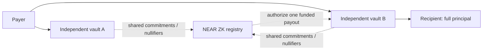

# Core Front — invoices, proofs and business workflows

[English](README.md) · [한국어](README.ko.md) · [简体中文](README.zh-CN.md)

基于 NEAR 的企业隐私结算：独立金库持有本金，共享零知识票据授权付款，选择披露证据用于对账。

Front 仓库提供 Next.js 落地页、文档及应用。

`/relay/` 支持可选延迟执行：持久化随机执行时间、每批最多八笔独立交易，以及等待、取消、过期和原请求恢复。[调度指南](https://github.com/Company-privacy-settlement/Core/blob/main/docs/SCHEDULED_DELIVERY.md)。这不代表匿名性证明或已上线的公共中继。

延迟执行验证：**565 项 Core 测试**、**8 项 Front 单元测试**、真实原生/FT WASM 与 Groth16 调度，以及桌面/移动端等待、恢复和证明 UX。公开 USDC 与外部 HTTPS 中继验证仍待完成。

## 项目简介

企业需要向供应商、员工和承包商付款，同时避免将发票条款及业务文档公开上链。Core 结合收款人签名请求、本地证明和可审核证据，并将本金分布在独立金库中。

[Hackathon guide](https://github.com/Company-privacy-settlement/Core/blob/main/docs/HACKATHON.md) · [Web Docs](https://core-private-settlement-0574c4.jiheon6768.chatgpt.site/docs/) · [Core](https://github.com/Company-privacy-settlement/Core) · [Contract](https://github.com/Company-privacy-settlement/Contract) · [Front](https://github.com/Company-privacy-settlement/Front)

## 观看演示

[](https://github.com/Company-privacy-settlement/Front/blob/main/public/media/core-hackathon-demo-en.mp4)

[Watch English MP4](https://github.com/Company-privacy-settlement/Front/blob/main/public/media/core-hackathon-demo-en.mp4) · [Captions, transcript & chapters](https://github.com/Company-privacy-settlement/Front/blob/main/docs/HACKATHON_DEMO.md) · [Hosted video player](https://core-private-settlement-0574c4.jiheon6768.chatgpt.site/media/)

提供英文旁白、字幕及真实应用画面。浏览器片段标明钱包/API 测试环境，并生成真实本地证明。独立章节展示已记录的原生 NEAR 公开测试网验证。

仓库与站点保留现有访问权限。视频位于 Front；评审需要 Front 权限或下载的视频包。本次提交准备不改变共享范围。

## 已实现功能

| 能力 | 实现 |
| --- | --- |
| 发票→付款 | 签名请求→加密票据→本地证明→金额/费用审核→钱包调用→确认。 |
| 隐私工作区 | 票据、证明验证/取消、选择证据和加密本地日志。 |
| 组织 | 成员/角色、发票看板、付款审批、批量付款、webhook 与审核流程。 |
| 税务草稿 | 来源绑定提纲、可选 AI 计划、不可变修订及独立审核。 |
| 文档 | 英文优先落地页和十份网页指南，英/韩/简中 README。 |

## 本地运行

需要 Node.js 22.16+，无需兄弟仓库或 API 密钥即可构建，静态输出为 `out/`。浏览器结算需要独立信任的 FT 策略和另行配置的 Core/组织 API；原生证据策略不能作为 USDC 浏览器策略。

```bash
npm ci
npm run dev
# Production export and checks
npm run check
npm test
npm run build
```

Routes: `/docs/`, `/invoices/`, `/pay/`, `/notes/`, `/prove/`, `/evidence/`, `/organization/`, `/rules/`, `/kyb/`, `/live/`. Demo media is under `public/media/`; fixture recording tools are under `scripts/demo/` and are excluded from the application runtime.

## 真实测试网证据

2026-11-14 确认 **14 笔真实公开测试网交易达到 FINAL**：部署/移除密钥、两笔 0.1 NEAR 入金、付款，以及收款账户不存在后向原目的地恢复。两名收款人均收到完整 0.1 NEAR，重试无第二次协议费。注册表与两个金库均无访问密钥；独立只读验证程序重新查询收据、签名、历史前后余额及合计 0.0006 NEAR 协议费。

[Testnet run and transaction links](https://github.com/Company-privacy-settlement/Core/blob/main/docs/TESTNET_WALLET.md) · [Public evidence](https://github.com/Company-privacy-settlement/Core/blob/main/docs/evidence/testnet-wallet-2026-11-14.json)

最近记录的工程验证为 **513 项 Core 测试**、SDK/类型构建及编译服务重启/备份/恢复。浏览器测试环境与公开原生实交易证据分别记录。

## 架构与费用



入金与出金各在本金之外加收 **0.15%**。收款人收到完整本金。NEAR 操作存储、代币注册、账户激活及网络 gas 单独计算。

ZK 隐藏使用了哪一张输入票据。签名人、收款人、时间、固定金额、金库及资金来源仍公开。单一付款人测试不证明有效匿名性。当前无 cover traffic 调度，每组总输出上限为 256。

## 范围与后续工作

**黑客松/开发原型**，设置为 `UNSAFE_LOCAL_DEVELOPMENT_ONLY`。公开测试网验证仅覆盖本地 Ed25519 软件钱包的原生 NEAR。真实浏览器钱包/USDC、外部 API HTTPS 验收、远程 Actions 成功及生产安全审核尚待完成。

下一步优先非托管中继、自愿随机延迟/批处理、隐私测量，再评估有预算限制的 cover traffic。真实 KYB/AI 服务资格、专业规则批准和法定申报仍需独立验证。

## 探索项目

[Service](https://github.com/Company-privacy-settlement/Core/blob/main/docs/SERVICE.md) · [Privacy](https://github.com/Company-privacy-settlement/Core/blob/main/docs/PRIVACY.md) · [Invoices](https://github.com/Company-privacy-settlement/Core/blob/main/docs/INVOICE_PAYMENTS.md) · [Organizations](https://github.com/Company-privacy-settlement/Core/blob/main/docs/ORGANIZATIONS.md) · [Tax drafts](https://github.com/Company-privacy-settlement/Core/blob/main/docs/TAX_DRAFTS.md) · [Deployment](https://github.com/Company-privacy-settlement/Core/blob/main/docs/DEPLOYMENT.md) · [Hosting](https://github.com/Company-privacy-settlement/Core/blob/main/docs/PRODUCTION_HOSTING.md) · [CI](https://github.com/Company-privacy-settlement/Core/blob/main/docs/CI.md) · [Roadmap](https://github.com/Company-privacy-settlement/Core/blob/main/docs/ROADMAP.md)
